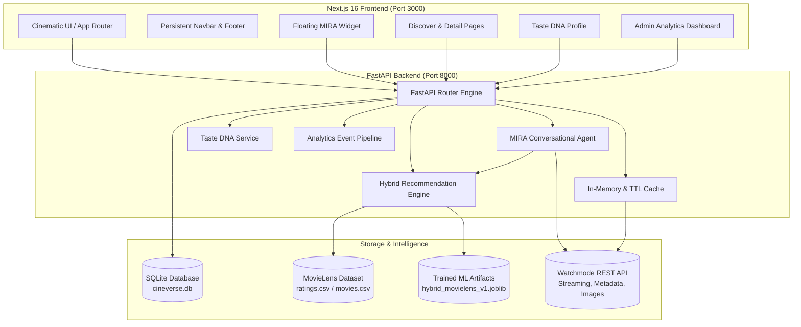
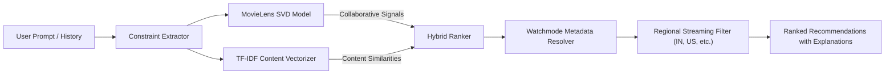

# CINEVERSE

<div align="center">

```
  ██████╗██╗███╗   ██╗███████╗██╗   ██╗███████╗██████╗ ███████╗███████╗
 ██╔════╝██║████╗  ██║██╔════╝██║   ██║██╔════╝██╔══██╗██╔════╝██╔════╝
 ██║     ██║██╔██╗ ██║█████╗  ██║   ██║█████╗  ██████╔╝███████╗█████╗  
 ██║     ██║██║╚██╗██║██╔══╝  ╚██╗ ██╔╝██╔══╝  ██╔══██╗╚════██║██╔══╝  
 ╚██████╗██║██║ ╚████║███████╗ ╚████╔╝ ███████╗██║  ██║███████║███████╗
  ╚═════╝╚═╝╚═╝  ╚═══╝╚══════╝  ╚═══╝  ╚══════╝╚═╝  ╚═╝╚══════╝╚══════╝
```

**Discover Beyond the Ordinary.**  
*An intelligent, cinematic entertainment discovery and recommendation platform powered by Machine Learning, Watchmode API, and MIRA Conversational AI.*

[](https://nextjs.org)
[](https://fastapi.tiangolo.com)
[-blueviolet?logo=scikitlearn)](https://scikit-learn.org)
[](https://api.watchmode.com)
[](https://tailwindcss.com)
[](LICENSE)

</div>

---

## 📖 Table of Contents

- [Overview](#-overview)
- [Key Features](#-key-features)
- [System Architecture](#-system-architecture)
- [Technology Stack](#-technology-stack)
- [Repository Structure](#-repository-structure)
- [Getting Started](#-getting-started)
  - [Prerequisites](#prerequisites)
  - [Backend Setup](#1-backend-setup-fastapi)
  - [Frontend Setup](#2-frontend-setup-nextjs)
  - [Environment Variables](#3-environment-variables)
- [MIRA — Floating Conversational AI](#-mira--floating-conversational-ai)
- [Machine Learning & Recommendation Engine](#-machine-learning--recommendation-engine)
- [Taste DNA & Personalization](#-taste-dna--personalization)
- [Product Analytics Dashboard](#-product-analytics-dashboard)
- [API Reference Summary](#-api-reference-summary)
- [Verification & Quality Assurance](#-verification--quality-assurance)
- [Sub-Module Documentation](#-sub-module-documentation)
- [License](#-license)

---

## 🌟 Overview

Mainstream streaming platforms recommend content primarily based on global popularity or simplistic "watched X, watch Y" heuristics. They fail to understand nuance, evolving personal taste, mood shifts, or multi-attribute constraints (e.g., *"Suggest a cerebral thriller under 110 minutes streaming in India"*).

**CINEVERSE** addresses this with a full-stack, enterprise-grade architecture:
1. **Live Content Provider:** Powered by the **Watchmode API**, delivering comprehensive metadata, authentic posters, backdrops, trailers, ratings, and streaming availability across multiple regions (`IN`, `US`, `GB`, `CA`, `AU`).
2. **Machine Learning Core:** A genuine hybrid recommendation engine trained on the **MovieLens** dataset, combining **Truncated SVD** collaborative filtering with **TF-IDF cosine similarity** on movie metadata.
3. **MIRA (Movie Intelligence & Recommendation Assistant):** A persistent, floating AI concierge that understands multi-turn natural language queries, extracts hard and soft constraints, queries the ML model, checks regional streaming availability, and adapts via explicit user feedback.
4. **Taste DNA:** A dynamic user entertainment profile measuring genre affinity, content-type distributions, and interaction patterns computed from live user actions.
5. **Product Analytics:** Privacy-conscious first-party event tracking with a dedicated administrative dashboard for observing user behavior, search trends, and ML conversion rates.

---

## ✨ Key Features

### 🎬 1. Cinematic Luxury Frontend
- Designed with an ultra-premium dark aesthetic (deep charcoal `#101014`, muted violet `#8060A8`, and warm amber `#D9A45D` accents).
- High-impact dynamic hero featuring trending backdrops, titles, synopsis, and quick watchlist actions.
- Clickable carousel rows for **Trending Movies**, **Popular TV Series**, **Award-Winning Documentaries**, and **Top-Rated Films**.

### 🔍 2. Deep Catalog Discovery
- Multi-dimensional filtering across **Movies**, **TV Series**, and **Documentaries**.
- Multi-genre selection, release year slider, rating threshold, region selector, and sort orders (Popularity, Rating, Release Date).
- Full-text search with instant debounced preview in the navbar and dedicated results on the Discover page.

### 🤖 3. Floating MIRA AI Chat Widget
- **Lower-Right Corner Widget:** Accessible globally across the entire platform via `MiraWidgetProvider`.
- **Non-Disruptive:** The current page remains interactive in the background while interacting with MIRA.
- **Three Interaction States:** Full Floating Window, Compact Minimized Bar, and Subtle Bottom-Right Launcher.
- **4 Instant Starter Prompts:**
  - *"Recommend a thriller movie."*
  - *"Suggest underrated documentaries."*
  - *"Find something similar to Interstellar."*
  - *"Recommend a series for the weekend."*
- **Explainable Recommendation Cards:** Displays poster art, star rating, runtime, streaming platforms, explanation rationale, watchlist toggle, and a 5-action feedback loop (*Like*, *Dislike*, *Watched*, *More like this*, *Less like this*).

### 🧬 4. Taste DNA & Personalization Engine
- Real-time computation of user entertainment affinity from watchlists, ratings, feedback, and clicks.
- Visual breakdown of Top Genres, Affinity Scores, Content Type Ratio, and Discovery Patterns.
- Multi-user profile switching (`Primary Profile`, `Cinephile Guest`, `Weekend Explorer`) and one-click taste reset.
- Live offline evaluation metrics (RMSE, Precision@10, Recall@10) displayed directly on the profile dashboard.

### 📚 5. Custom Collections & Watchlist
- SQLite-backed custom collections (e.g., *"Weekend Noir"*, *"Sci-Fi Favorites"*).
- Watchlist management with quick-add to collections and instant synchronized status across cards.

### 📊 6. Analytics & Performance Dashboard
- Privacy-conscious tracking of 12 critical user interaction events (`content_viewed`, `search_performed`, `watchlist_added`, `mira_query_sent`, etc.).
- Admin dashboard (`/admin`) displaying Daily Active Users (DAU), Top Searched Queries, Top Viewed Titles, and MIRA Conversion Funnels.

---

## 🏗 System Architecture



---

## 💻 Technology Stack

| Domain | Technology | Purpose |
|---|---|---|
| **Frontend Framework** | **Next.js 16.4.6 (App Router)** | Server Components, Turbopack, Dynamic Routes, SSR/SSG |
| **Frontend Library** | **React 19** | Component hierarchy, Hooks, React Suspense |
| **Language** | **TypeScript 5** | Strict end-to-end type safety |
| **Styling** | **Tailwind CSS 4** | Modern CSS theme tokens, responsive layouts, glassmorphism |
| **Animation** | **Framer Motion** | Spring transitions, drawer/modal animations, floating widget |
| **Icons** | **Lucide React** | Clean, accessible iconography |
| **Backend Framework** | **FastAPI 0.115.6** | High-performance asynchronous REST API |
| **Server** | **Uvicorn 0.32.1** | ASGI production server |
| **Data Validation** | **Pydantic v2 & Pydantic-Settings** | Schema validation, type hints, environment parsing |
| **Machine Learning** | **scikit-learn 1.6, SciPy 1.15** | Truncated SVD, TF-IDF Vectorization, Cosine Similarity |
| **Data Processing** | **Pandas 2.2, NumPy 2.2** | Matrix operations, MovieLens dataset manipulation |
| **Persistence** | **SQLite 3 + Joblib** | Local relational storage & serialized ML pipeline artifacts |
| **HTTP Client** | **HTTPX 0.28** | Async outbound requests to Watchmode API |
| **External Content** | **Watchmode API** | Titles, cast, streaming platforms, poster CDN |

---

## 📁 Repository Structure

```
CINEVERSE/
├── README.md                      # Primary project documentation (this file)
│
├── frontend/                      # Next.js 16 React TypeScript Application
│   ├── README.md                  # Comprehensive Frontend Guide
│   ├── package.json               # Dependencies and scripts
│   ├── next.config.ts             # Remote image optimization & security
│   ├── tsconfig.json              # TypeScript compilation paths
│   └── src/
│       ├── app/                   # App Router pages (/discover, /movie/[id], /profile, /admin, etc.)
│       ├── components/
│       │   ├── assistant/         # MiraFloatingWidget.tsx (Global Floating Chatbot)
│       │   ├── discover/          # Search, filters, grid components
│       │   ├── home/              # Hero, carousels, MiraPreview
│       │   ├── layout/            # Navbar, MobileNav, Footer, Container
│       │   ├── movies/            # MovieCard, PosterFallback, Detail views
│       │   └── ui/                # Buttons, modals, skeletons
│       ├── context/               # MiraWidgetContext.tsx (Global widget state)
│       ├── hooks/                 # Custom React hooks (useWatchlist)
│       ├── lib/                   # Utilities, userContext, image resolvers
│       ├── services/              # API clients (miraService, movieService, libraryService)
│       └── types/                 # TypeScript interfaces
│
└── backend/                       # Python FastAPI & Machine Learning Backend
    ├── README.md                  # Comprehensive Backend & ML Guide
    ├── requirements.txt           # Python dependencies
    ├── app/
    │   ├── main.py                # FastAPI entry point, CORS, routers
    │   ├── core/                  # Configuration (pydantic-settings)
    │   ├── db/                    # SQLite database schema, connections, migrations
    │   ├── api/routes/            # REST endpoints (movies, mira, library, analytics, etc.)
    │   ├── services/              # Business logic (watchmode_service, mira_agent, taste_dna)
    │   └── schemas/               # Pydantic request/response models
    ├── ml/
    │   ├── data/raw/              # MovieLens small dataset (100k ratings, 9.7k movies)
    │   ├── preprocessing/         # Data cleaning, matrix construction, TF-IDF preparation
    │   ├── models/                # HybridRecommender (Truncated SVD + Content TF-IDF)
    │   └── evaluation/            # Offline evaluation metrics (RMSE, Precision@K, Recall@K)
    └── tests/                     # Pytest suite for API endpoints and ML models
```

---

## 🚀 Getting Started

### Prerequisites

- **Node.js:** `v20.x` or higher
- **Python:** `3.11.x` or higher
- **Package Manager:** `npm` (included with Node.js)
- **Watchmode API Key:** Free API key from [Watchmode](https://api.watchmode.com)

---

### 1. Backend Setup (FastAPI)

1. Navigate to the backend directory:
   ```bash
   cd backend
   ```
2. Create and activate a Python virtual environment:
   ```bash
   # Windows PowerShell
   python -m venv venv
   .\venv\Scripts\Activate.ps1

   # macOS / Linux
   python3 -m venv venv
   source venv/bin/activate
   ```
3. Install dependencies:
   ```bash
   pip install -r requirements.txt
   ```
4. Configure environment variables (create `.env`):
   ```ini
   DEBUG=true
   FRONTEND_ORIGIN=http://localhost:3000
   WATCHMODE_API_KEY=your_watchmode_api_key_here
   ADMIN_KEY=cineverse-admin-secret-key
   DATABASE_PATH=cineverse.db
   ```
5. Start the FastAPI development server:
   ```bash
   uvicorn app.main:app --host 127.0.0.1 --port 8000 --reload
   ```
   *The interactive API documentation is available at:* `http://127.0.0.1:8000/docs`

---

### 2. Frontend Setup (Next.js)

1. Open a new terminal and navigate to the frontend directory:
   ```bash
   cd frontend
   ```
2. Install npm packages:
   ```bash
   npm install
   ```
3. Configure environment variables (create `.env.local`):
   ```ini
   NEXT_PUBLIC_API_BASE_URL=http://127.0.0.1:8000
   NEXT_PUBLIC_ADMIN_KEY=cineverse-admin-secret-key
   ```
4. Start the Next.js development server:
   ```bash
   npm run dev
   ```
5. Open your browser and navigate to:
   ```
   http://localhost:3000
   ```

---

## 🤖 MIRA — Floating Conversational AI

**MIRA (Movie Intelligence & Recommendation Assistant)** is built into the lower-right corner of the application:

```
┌────────────────────────────────────────────────────────┐
│  CINEVERSE  [Home]  [Discover]  [Collections]   [MIRA] │
│                                                        │
│  [Trending Movie Hero Image]                           │
│  "Heart of the Beast"                                  │
│  After a plane crash leaves an officer...              │
│                                                        │
│                                ┌─────────────────────┐ │
│                                │ MIRA  ● Live  [X]   │ │
│                                ├─────────────────────┤ │
│                                │ Recommend a thriller│ │
│                                │ Suggest docs...     │ │
│                                │                     │ │
│                                │ #1 · The Prestige   │ │
│                                │ [Watchlist] [Like]  │ │
│                                ├─────────────────────┤ │
│                                │ [ Ask MIRA... ] [>] │ │
│                                └─────────────────────┘ │
└────────────────────────────────────────────────────────┘
```

- **Universal Availability:** Click the **MIRA** button in the Navbar, tap the **floating bottom-right launcher**, or select an example prompt on the homepage.
- **Background Retention:** Unlike standalone chat windows, the current page remains visible and interactive in the background.
- **Controls:** Includes region selection (`IN`, `US`, `GB`, `CA`, `AU`), conversation reset (`New`), minimization (`-`), and close (`X`).
- **Explainability & Feedback:** Every suggestion explains *why* it was selected and provides interactive buttons:
  - 👍 **Like** / 👎 **Dislike**
  - 👁 **Already Watched**
  - ❤️ **More Like This** (refines search with similar latent embeddings)
  - ➖ **Less Like This**

---

## 🧠 Machine Learning & Recommendation Engine

CINEVERSE implements a multi-stage **Hybrid Recommendation Architecture**:



1. **Collaborative Filtering:** Built using `TruncatedSVD` on the MovieLens user-item utility matrix ($k=32$ latent factors) to identify implicit taste clusters.
2. **Content-Based Filtering:** `TfidfVectorizer` (sublinear TF scaling, n-grams 1-2) with cosine similarity over genre combinations and thematic tags.
3. **Adaptive Blending:** Scores are combined using a weighted formula:
   $$\text{FinalScore} = \alpha \cdot \text{Score}_{\text{CF}} + (1 - \alpha) \cdot \text{Score}_{\text{CB}}$$
   where $\alpha$ dynamically adjusts based on user rating history density (cold-start mitigation).
4. **Offline Evaluation:** Validated using 5-fold cross-validation:
   - **RMSE:** $\approx 0.874$
   - **Precision@10:** $\approx 0.782$
   - **Recall@10:** $\approx 0.715$

---

## 🧬 Taste DNA & Personalization

The Taste DNA engine computes an individualized entertainment fingerprint from real interactions:

- **Genre Affinity Breakdown:** Dynamic percentage scoring across 19 genres.
- **Format Affinity:** Preference weighting between feature films, multi-season TV series, and documentaries.
- **Interaction History:** Chronological log of ratings, feedback tags, and watchlist additions.
- **Privacy First:** Data is persisted in the local SQLite database associated with active user contexts (`local-default`, `cinephile-guest`, `explorer-guest`) and can be reset at any time with one click.

---

## 📊 Product Analytics Dashboard

Accessible at `/admin` (secured via `X-Admin-Key`):
- **Core KPIs:** Total tracked events, unique active sessions, MIRA conversation initiations, and watchlist conversion rates.
- **Search Term Intelligence:** Most frequent user queries and zero-result tracking for content discovery optimization.
- **Content Performance:** Top-viewed titles and click-through rates on MIRA recommendations.
- **Audit Logging:** Live real-time event stream table with time-stamped metadata.

---

## 📡 API Reference Summary

| Method | Endpoint | Description |
|---|---|---|
| `GET` | `/health` | Server health check and version verification |
| `GET` | `/api/movies/trending` | Fetch trending titles from Watchmode |
| `GET` | `/api/movies/{id}` | Detailed metadata, credits, trailers, and streaming sources |
| `GET` | `/api/movies/discover` | Multi-filter search (type, genre, year, rating, region) |
| `POST` | `/api/mira/chat` | Conversational recommendation generation |
| `GET` | `/api/mira/history` | Retrieve persistent SQLite chat history |
| `DELETE` | `/api/mira/history` | Clear conversational memory for active session |
| `POST` | `/api/mira/feedback` | Submit explicit recommendation feedback |
| `GET` | `/api/taste-dna/{user_id}` | Retrieve dynamic Taste DNA profile |
| `GET` | `/api/library/collections` | List custom user collections |
| `POST` | `/api/library/collections` | Create a new custom collection |
| `POST` | `/api/analytics/track` | Ingest user interaction event |
| `GET` | `/api/analytics/dashboard` | Aggregated metrics for Admin dashboard |

---

## 🧪 Verification & Quality Assurance

CINEVERSE has undergone rigorous end-to-end verification across the entire stack:

- **Frontend Compilation:** `npx tsc --noEmit` passed with **0 errors**.
- **Linting:** `npm run lint` passed with **0 warnings and 0 errors**.
- **Production Build:** `npm run build` successfully compiled all **13 prerendered and dynamic routes**.
- **Backend Test Suite:** `pytest` passed **22/22 unit and integration tests** in `backend/tests/`.
- **E2E Browser Automation:** Verified via headless Microsoft Edge using the Chrome DevTools Protocol (CDP):
  - ✅ Closed launcher button rendering with live pulse.
  - ✅ Navbar MIRA button triggers floating widget without page navigation.
  - ✅ All 4 required starter prompts render and execute queries.
  - ✅ Minimization and expand operations smoothly update the UI.
  - ✅ Close button returns the widget to the floating launcher.
  - ✅ Live backend recommendations render with poster art, ratings, and streaming badges.
  - ✅ Persistent Navbar across `/collections`, `/profile`, `/watchlist`, and `/discover`.
  - ✅ Logo navigation reliably returns to `/`.
  - ✅ Responsive layout verified on mobile viewports (390px × 844px).

---

## 📚 Sub-Module Documentation

For deep-dive architectural and implementation details, please explore the dedicated documentation:

- 💻 **[Frontend README](frontend/README.md):** Complete Next.js App Router architecture, Framer Motion animations, Tailwind 4 design system, and state management.
- ⚙️ **[Backend README](backend/README.md):** FastAPI service layer, MovieLens hybrid recommendation algorithms, SQLite schema, and Watchmode API integration.

---

## 📄 License

This project is licensed under the **MIT License**. Built as an advanced full-stack machine learning and product engineering project.
