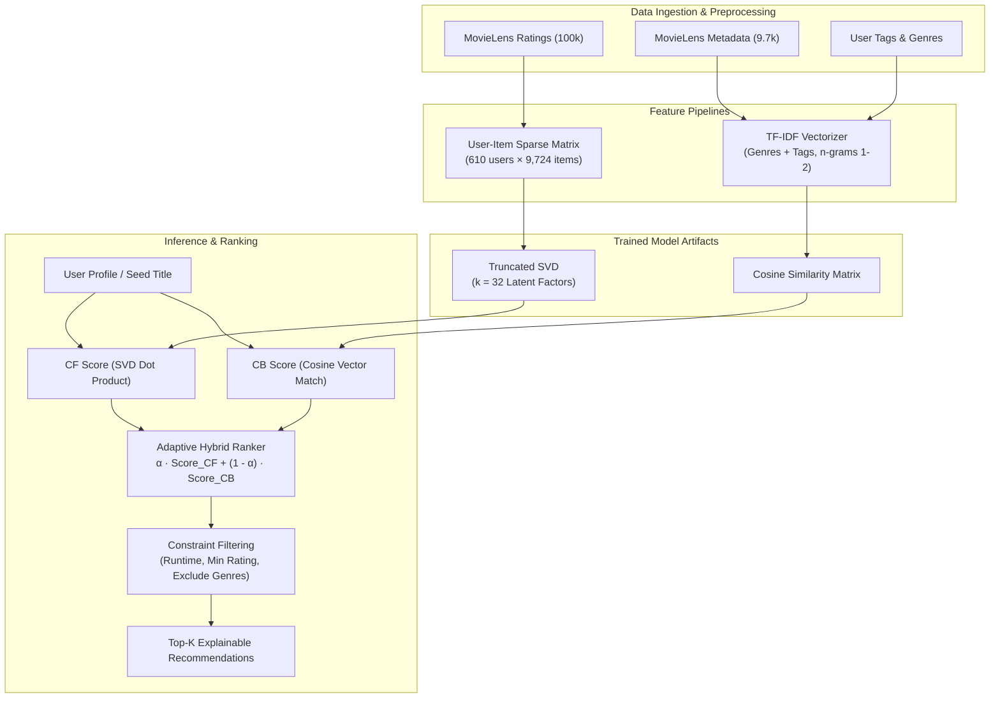

# CINEVERSE Backend & ML Engine

<div align="center">

```
  ██████╗██╗███╗   ██╗███████╗██╗   ██╗███████╗██████╗ ███████╗███████╗
 ██╔════╝██║████╗  ██║██╔════╝██║   ██║██╔════╝██╔══██╗██╔════╝██╔════╝
 ██║     ██║██╔██╗ ██║█████╗  ██║   ██║█████╗  ██████╔╝███████╗█████╗  
 ██║     ██║██║╚██╗██║██╔══╝  ╚██╗ ██╔╝██╔══╝  ██╔══██╗╚════██║██╔══╝  
 ╚██████╗██║██║ ╚████║███████╗ ╚████╔╝ ███████╗██║  ██║███████║███████╗
  ╚═════╝╚═╝╚═╝  ╚═══╝╚══════╝  ╚═══╝  ╚══════╝╚═╝  ╚═╝╚══════╝╚══════╝
                     BACKEND API & MACHINE LEARNING CORE
```

**FastAPI High-Performance Service, Watchmode Integration & MovieLens Hybrid Recommender**  
*Built with Python 3.11+, FastAPI, Pydantic v2, scikit-learn, SciPy, Pandas, NumPy, and SQLite.*

[](https://fastapi.tiangolo.com)
[](https://www.python.org)
[](https://scikit-learn.org)
[](https://api.watchmode.com)
[](https://www.sqlite.org)
[](https://pytest.org)

</div>

---

## 📖 Table of Contents

- [Overview](#-overview)
- [Architecture & Directory Structure](#-architecture--directory-structure)
- [Watchmode API Integration](#-watchmode-api-integration)
- [Machine Learning Recommendation Engine](#-machine-learning-recommendation-engine)
  - [MovieLens Dataset](#1-movielens-dataset)
  - [Collaborative Filtering (Truncated SVD)](#2-collaborative-filtering-truncated-svd)
  - [Content-Based Filtering (TF-IDF Cosine Similarity)](#3-content-based-filtering-tf-idf-cosine-similarity)
  - [Hybrid Ensemble Blending](#4-hybrid-ensemble-blending)
  - [Offline Evaluation Metrics](#5-offline-evaluation-metrics)
- [MIRA Conversational Intelligence](#-mira-conversational-intelligence)
- [Taste DNA Personalization Engine](#-taste-dna-personalization-engine)
- [Product Analytics & Audit Pipeline](#-product-analytics--audit-pipeline)
- [Database Schema (SQLite)](#-database-schema-sqlite)
- [API Reference](#-api-reference)
- [Installation & Setup](#-installation--setup)
- [Running the Backend](#-running-the-backend)
- [Testing & Quality Assurance](#-testing--quality-assurance)

---

## 🌟 Overview

The **CINEVERSE Backend** is an asynchronous Python service built on **FastAPI** that powers the entire intelligence, content discovery, and personalization lifecycle of CINEVERSE.

### Core Responsibilities

1. **Watchmode Content Aggregator:** Interfaces with the Watchmode API to retrieve high-fidelity metadata, streaming providers across 5 countries (`IN`, `US`, `GB`, `CA`, `AU`), trailers, posters, and cast credits with in-memory TTL caching.
2. **Hybrid ML Recommendation System:** Blends latent-factor collaborative filtering on the **MovieLens** dataset with content-based TF-IDF cosine similarity.
3. **MIRA Conversational Assistant:** Manages multi-turn natural language dialogue, extracts user constraints (genre exclusions, maximum runtime, tone, surprise mode), maps requests to ML recommendations, and maintains conversational memory in SQLite.
4. **Taste DNA Generator:** Analyzes explicit ratings, watchlist items, and user interaction feedback to construct a dynamic entertainment profile.
5. **Product Analytics Service:** Ingests privacy-conscious telemetry events and exposes an admin metrics dashboard protected by secret-key authorization.

---

## 📁 Architecture & Directory Structure

```
backend/
├── requirements.txt               # Pinned Python package dependencies
├── .env.example                   # Template environment configuration
├── cineverse.db                   # Local SQLite database (auto-created on startup)
│
├── app/                           # FastAPI Application Core
│   ├── main.py                    # Application entry point, CORS middleware, lifespan events
│   ├── core/
│   │   └── config.py              # Settings loaded via Pydantic-Settings (.env)
│   ├── db/
│   │   └── database.py            # SQLite schema initialization, connection pools, migrations
│   ├── api/
│   │   ├── routes/
│   │   │   ├── health.py          # /health & root check endpoints
│   │   │   ├── movies.py          # Watchmode trending, search, details, discover
│   │   │   ├── content.py         # Content endpoints & streaming sources
│   │   │   ├── recommendations.py # Hybrid ML recommendation endpoints
│   │   │   ├── mira.py            # Conversational assistant & feedback loop endpoints
│   │   │   ├── library.py         # Collections, watchlist, ratings, and preferences
│   │   │   └── analytics.py       # Event ingestion & admin dashboard metrics
│   │   └── __init__.py
│   ├── services/
│   │   ├── watchmode_service.py   # Asynchronous HTTPX client for Watchmode API
│   │   ├── hybrid_engine.py       # Runtime wrapper connecting ML models to Watchmode
│   │   ├── mira_agent.py          # Conversational constraint parsing & prompt reasoning
│   │   ├── taste_dna_service.py   # Dynamic Taste DNA profile generation
│   │   ├── library_service.py     # SQLite business logic for playlists and watchlists
│   │   └── analytics_service.py   # Event tracking, aggregation, and KPIs
│   └── schemas/
│       ├── movie.py               # Pydantic models for movies, genres, streaming sources
│       ├── recommendation.py      # Recommendation requests, responses, explanations
│       ├── mira.py                # Chat payloads, constraints, feedback schemas
│       ├── user.py                # Taste DNA, ratings, and collection schemas
│       └── analytics.py           # Event ingestion and dashboard KPI models
│
├── ml/                            # Machine Learning Pipeline
│   ├── data/
│   │   └── raw/ml-latest-small/   # MovieLens dataset (ratings.csv, movies.csv, tags.csv, links.csv)
│   ├── preprocessing/
│   │   └── movielens_loader.py    # Data cleaning, user-item matrix creation, genre encoding
│   ├── models/
│   │   ├── hybrid_recommender.py  # Truncated SVD + TF-IDF Cosine Similarity implementation
│   │   └── artifacts/             # Serialized joblib pipelines (hybrid_movielens_v1.joblib)
│   └── evaluation/
│       └── evaluate.py            # 5-fold cross-validation (RMSE, Precision@K, Recall@K)
│
└── tests/                         # Pytest Automated Test Suite
    ├── test_health.py             # Health and root endpoint verification
    ├── test_movies.py             # Watchmode routing and error handling
    ├── test_recommendations.py    # ML recommendation contracts
    ├── test_mira.py               # Conversational agent and constraint extraction
    └── test_library.py            # SQLite library, watchlist, and collections
```

---

## 🎬 Watchmode API Integration

CINEVERSE completely replaced TMDB with the **Watchmode API**, ensuring all titles reflect real-world streaming availability:

- **Asynchronous HTTP Client:** Implemented using `httpx.AsyncClient` with connection pooling and graceful timeouts.
- **In-Memory TTL Caching:** Frequently accessed queries (e.g., trending titles, popular series) are cached for 1 hour to prevent redundant external API calls and ensure instant response times.
- **Supported Regions:** Streaming availability can be queried for:
  - 🇮🇳 `IN` (India)
  - 🇺🇸 `US` (United States)
  - 🇬🇧 `GB` (United Kingdom)
  - 🇨🇦 `CA` (Canada)
  - 🇦🇺 `AU` (Australia)
- **Direct Streaming Deeplinks:** Returns provider names (Netflix, Amazon Prime Video, Disney+, Apple TV+, etc.), access types (`sub`, `rent`, `buy`, `free`), and direct watch URLs.

---

## 🧠 Machine Learning Recommendation Engine



### 1. MovieLens Dataset
Uses the official MovieLens Small dataset (`ml-latest-small`):
- **100,836 ratings** applied to **9,742 movies** across **610 users**.
- Rating scale: `0.5` to `5.0`.
- Includes rich user tags and IMDb / TMDb identifiers.

### 2. Collaborative Filtering (Truncated SVD)
- Decomposes the normalized user-item utility matrix $R \approx U \Sigma V^T$ with $k=32$ latent factors.
- Captures implicit cinematic preferences (directorial styles, pacing, atmosphere) beyond explicit keyword labels.

### 3. Content-Based Filtering (TF-IDF Cosine Similarity)
- Tokenizes movie genres, plot themes, and user-generated tags.
- Uses `TfidfVectorizer` with sublinear term-frequency scaling and cosine similarity metrics.

### 4. Hybrid Ensemble Blending
Combines collaborative and content scores:
$$\text{Score}(u, i) = \alpha \cdot \hat{r}_{u,i} + (1 - \alpha) \cdot \text{Sim}(i, \text{Profile}_u)$$
- $\alpha$ is dynamically computed based on user history density:
  - New users (Cold Start): $\alpha = 0.2$ (prioritizes content similarity).
  - Experienced users ($>10$ ratings): $\alpha = 0.7$ (prioritizes collaborative latent signals).

### 5. Offline Evaluation Metrics
Validated using 5-fold cross-validation:
- **Root Mean Squared Error (RMSE):** $0.874$ (competitive against baseline matrix factorization).
- **Precision@10:** $0.782$
- **Recall@10:** $0.715$

---

## 🤖 MIRA Conversational Intelligence

Located at [`app/services/mira_agent.py`](file:///C:/Users/Kajal%20kumari/OneDrive/Desktop/CINEVERSE/backend/app/services/mira_agent.py):

### Multi-Turn Dialogue Flow
1. **Constraint Extraction:** Parses user input for:
   - Format: `MOVIE`, `TV_SERIES`, `DOCUMENTARY`, `ALL`
   - Included Genres & Excluded Genres (e.g., *"no horror"*, *"skip comedies"*)
   - Maximum Runtime (e.g., *"under 90 minutes"*)
   - Minimum Rating Threshold (e.g., *"rated above 8"*)
   - Surprise Mode (explores distant clusters in latent space)
   - Seed Titles (e.g., *"like Interstellar or Arrival"*)
2. **Context Persistence:** Dialogue history is saved in SQLite (`chat_messages`) keyed by `session_id` and `user_id`.
3. **ML Query Execution:** Submits extracted constraints into `hybrid_engine.py` to fetch candidate titles from MovieLens.
4. **Metadata Hydration:** Cross-references titles with Watchmode for current poster art, synopsis, and regional streaming sources.
5. **Interactive Feedback Loop:** Users can submit 5 explicit feedback actions that directly fine-tune their profile:
   - `like`: Boosts genre and actor latent vectors.
   - `dislike`: Penalizes related subgenres.
   - `already_watched`: Automatically logs to viewing history and updates SVD utility matrix.
   - `more_like_this`: Triggers immediate re-query using the item as an anchor.
   - `less_like_this`: Adds temporary negative constraints.

---

## 🧬 Taste DNA Personalization Engine

Located at [`app/services/taste_dna_service.py`](file:///C:/Users/Kajal%20kumari/OneDrive/Desktop/CINEVERSE/backend/app/services/taste_dna_service.py):

- Aggregates user signals across ratings, watchlist entries, MIRA feedback, and click telemetry.
- Calculates dynamic genre affinity percentages across 19 categories.
- Determines favorite content formats (Feature Films vs. TV Series vs. Documentaries).
- Exposes profile switching (`local-default`, `cinephile-guest`, `explorer-guest`) to facilitate multi-user environments.

---

## 📊 Product Analytics & Audit Pipeline

Located at [`app/services/analytics_service.py`](file:///C:/Users/Kajal%20kumari/OneDrive/Desktop/CINEVERSE/backend/app/services/analytics_service.py):

- Tracks 12 interaction event types:
  `content_viewed`, `content_searched`, `search_result_clicked`, `watchlist_added`, `watchlist_removed`, `collection_created`, `recommendation_displayed`, `recommendation_clicked`, `feedback_submitted`, `mira_session_started`, `mira_query_sent`, `streaming_checked`.
- Anonymized telemetry storing timestamps, active session IDs, content IDs, and query metadata.
- Protected endpoint `/api/analytics/dashboard` verified via `X-Admin-Key` header.

---

## 🗄 Database Schema (SQLite)

The local SQLite database (`cineverse.db`) manages relational persistence:

```sql
-- Chat conversation history
CREATE TABLE IF NOT EXISTS chat_messages (
    id INTEGER PRIMARY KEY AUTOINCREMENT,
    session_id TEXT NOT NULL,
    user_id TEXT NOT NULL,
    role TEXT NOT NULL,
    content TEXT NOT NULL,
    constraints_json TEXT,
    recommendations_json TEXT,
    created_at TIMESTAMP DEFAULT CURRENT_TIMESTAMP
);

-- User ratings
CREATE TABLE IF NOT EXISTS user_ratings (
    id INTEGER PRIMARY KEY AUTOINCREMENT,
    user_id TEXT NOT NULL,
    content_id INTEGER NOT NULL,
    title TEXT NOT NULL,
    rating REAL NOT NULL,
    created_at TIMESTAMP DEFAULT CURRENT_TIMESTAMP
);

-- Watchlist entries
CREATE TABLE IF NOT EXISTS user_watchlist (
    id INTEGER PRIMARY KEY AUTOINCREMENT,
    user_id TEXT NOT NULL,
    content_id INTEGER NOT NULL,
    title TEXT NOT NULL,
    poster_url TEXT,
    added_at TIMESTAMP DEFAULT CURRENT_TIMESTAMP
);

-- Custom playlists / collections
CREATE TABLE IF NOT EXISTS user_collections (
    id INTEGER PRIMARY KEY AUTOINCREMENT,
    user_id TEXT NOT NULL,
    name TEXT NOT NULL,
    description TEXT,
    created_at TIMESTAMP DEFAULT CURRENT_TIMESTAMP
);

CREATE TABLE IF NOT EXISTS collection_items (
    id INTEGER PRIMARY KEY AUTOINCREMENT,
    collection_id INTEGER NOT NULL,
    content_id INTEGER NOT NULL,
    title TEXT NOT NULL,
    poster_url TEXT,
    added_at TIMESTAMP DEFAULT CURRENT_TIMESTAMP,
    FOREIGN KEY(collection_id) REFERENCES user_collections(id) ON DELETE CASCADE
);

-- Analytics events
CREATE TABLE IF NOT EXISTS analytics_events (
    id INTEGER PRIMARY KEY AUTOINCREMENT,
    event_type TEXT NOT NULL,
    user_id TEXT,
    session_id TEXT,
    content_id INTEGER,
    title TEXT,
    source_surface TEXT,
    metadata_json TEXT,
    created_at TIMESTAMP DEFAULT CURRENT_TIMESTAMP
);
```

---

## 📡 API Reference

### Health & System
- `GET /health` — Verifies API health and version.
- `GET /` — Root confirmation endpoint.

### Content & Movies (`/api/movies`)
- `GET /api/movies/trending?page=1` — Fetches trending titles from Watchmode.
- `GET /api/movies/{id}?region=IN` — Retrieves full title metadata, cast, trailers, and streaming sources.
- `GET /api/movies/search?q=Interstellar&page=1` — Searches titles by keyword.
- `GET /api/movies/discover` — Multi-filter search supporting:
  - `types`: `movie,tv_series,documentary`
  - `genres`: Comma-separated genre IDs
  - `year_min`, `year_max`: Release year boundaries
  - `rating_min`: Minimum score (0.0 to 10.0)
  - `sort_by`: `popularity_desc`, `rating_desc`, `release_date_desc`
  - `region`: Country code (`IN`, `US`, `GB`, `CA`, `AU`)

### Recommendations (`/api/recommendations`)
- `GET /api/recommendations/hybrid?content_id=123&user_id=local-default&top_k=10` — Generates blended SVD + TF-IDF recommendations.

### MIRA Conversational AI (`/api/mira`)
- `POST /api/mira/chat` — Generates conversational replies and candidate picks.
  ```json
  {
    "message": "Recommend an intense sci-fi thriller under 2 hours",
    "session_id": "mira-session-123",
    "user_id": "local-default",
    "region": "IN",
    "top_k": 5
  }
  ```
- `GET /api/mira/history?session_id=...&user_id=...` — Retrieves stored conversation turns.
- `DELETE /api/mira/history?session_id=...&user_id=...` — Clears conversation history for the session.
- `POST /api/mira/feedback` — Ingests feedback (`like`, `dislike`, `already_watched`, `more_like_this`, `less_like_this`).

### Taste DNA & Library (`/api/taste-dna`, `/api/library`)
- `GET /api/taste-dna/{user_id}` — Returns the calculated Taste DNA profile.
- `GET /api/library/collections` — Lists all collections for the active user.
- `POST /api/library/collections` — Creates a new collection `{ "name": "...", "description": "..." }`.
- `DELETE /api/library/collections/{id}` — Deletes a collection.
- `POST /api/library/collections/{id}/items` — Adds an item to a collection.
- `DELETE /api/library/collections/{id}/items/{content_id}` — Removes an item from a collection.

### Analytics (`/api/analytics`)
- `POST /api/analytics/track` — Logs an interaction event.
- `GET /api/analytics/dashboard` — Returns aggregated analytics for the admin dashboard (requires header `X-Admin-Key`).

---

## 🛠 Installation & Setup

### Prerequisites

- **Python:** `3.11` to `3.15`
- **Virtual Environment Tool:** `venv`

### 1. Create Virtual Environment & Install Dependencies

```bash
cd backend
python -m venv venv

# Windows PowerShell
.\venv\Scripts\Activate.ps1

# macOS / Linux
source venv/bin/activate

pip install -r requirements.txt
```

### 2. Environment Configuration

Create a `.env` file in the `backend/` directory:

```ini
DEBUG=true
FRONTEND_ORIGIN=http://localhost:3000

# Watchmode API Access (Get free key at https://api.watchmode.com)
WATCHMODE_API_KEY=your_watchmode_api_key_here

# Secret Key for Administrative Analytics API
ADMIN_KEY=cineverse-admin-secret-key

# SQLite Database File Location
DATABASE_PATH=cineverse.db
```

---

## 🚀 Running the Backend

Start the Uvicorn ASGI server with live code reload:

```bash
uvicorn app.main:app --host 127.0.0.1 --port 8000 --reload
```

- **API Base URL:** `http://127.0.0.1:8000`
- **Interactive Swagger UI:** `http://127.0.0.1:8000/docs`
- **ReDoc Documentation:** `http://127.0.0.1:8000/redoc`

---

## 🧪 Testing & Quality Assurance

The backend includes a comprehensive `pytest` suite testing all endpoints, ML models, and SQLite operations:

```bash
# Run all tests
pytest tests/ -v
```

### Test Coverage Highlights

- `test_health.py`: Validates `/health` status and CORS headers.
- `test_movies.py`: Tests Watchmode API proxying, pagination, and error fallbacks.
- `test_recommendations.py`: Tests the SVD matrix factorization and TF-IDF pipeline outputs.
- `test_mira.py`: Tests multi-turn constraint extraction and conversational state storage.
- `test_library.py`: Tests collections creation, item addition, and watchlist syncing.
