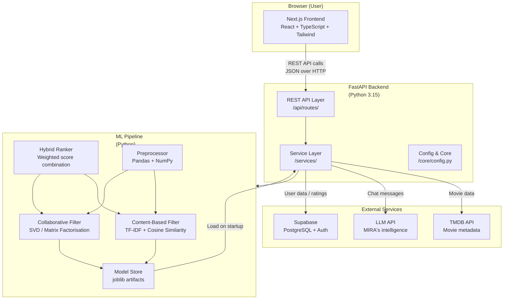

# CINEVERSE — System Architecture

> Last updated: Day 1

---

## Overview

CINEVERSE is built as a monorepo containing a Next.js frontend, a FastAPI backend, and an ML pipeline. These three systems communicate through well-defined interfaces: the frontend talks to the backend via REST API, and the backend orchestrates the ML models internally.

---

## Architecture Diagram



---

## Module Responsibilities

### Frontend Module

**Location:** `frontend/src/`

The frontend is a Next.js application using the App Router. It is responsible for all user-facing screens and interactions.

| Sub-module | Responsibility |
|---|---|
| `app/` | Page components. Each folder is a URL route. |
| `components/` | Reusable UI components. |
| `services/api.ts` | Centralised backend communication. |
| `hooks/` | Custom React hooks (data fetching, state). |
| `types/` | Shared TypeScript interfaces. |
| `lib/utils.ts` | Pure utility functions. |

**Pages planned:**
- `/` — Homepage with featured films and hero section
- `/discover` — Browse and filter movies
- `/movie/[id]` — Movie detail page with recommendations
- `/assistant` — MIRA conversational interface
- `/watchlist` — Saved movies
- `/history` — Viewing history and ratings
- `/profile` — User settings and Taste DNA

---

### Backend Module

**Location:** `backend/app/`

The backend is a FastAPI application. It is the bridge between the frontend, the ML pipeline, and all external services.

| Sub-module | Responsibility |
|---|---|
| `main.py` | App wiring: middleware, router registration, startup events. |
| `api/routes/` | Thin HTTP handlers. Each route delegates to a service. |
| `core/config.py` | Type-safe settings loaded from environment variables. |
| `services/` | Business logic: recommendation orchestration, TMDB calls, chat handling. |
| `schemas/` | Pydantic models for request/response validation. |
| `models/` | Database models (Supabase interaction layer). |
| `utils/` | Backend-specific utilities. |

**Key design decision:** Routes are kept thin. They validate input (via Pydantic schemas), call a service, and return the response. All logic lives in services, making it testable without HTTP overhead.

---

### ML Module

**Location:** `backend/ml/`

The ML pipeline is responsible for generating movie recommendations. It runs as a set of Python scripts and trained model artifacts that the backend loads at startup.

| Sub-module | Responsibility |
|---|---|
| `preprocessing/` | Load raw movie datasets, clean, extract features. |
| `models/` | Saved model artifacts (TF-IDF matrix, SVD model, etc.). |
| `evaluation/` | Offline evaluation: precision@k, NDCG, coverage. |
| `notebooks/` | Jupyter notebooks for exploration and prototyping. |
| `data/` | Raw and processed datasets (not committed to git). |

**Three recommendation strategies:**

1. **Content-Based Filtering (CBF)**
   - Builds a TF-IDF representation of each movie using title, overview, genres, cast, and director.
   - Computes cosine similarity between movies.
   - Used to find films "similar to this one".

2. **Collaborative Filtering (CF)**
   - Learns from patterns in user ratings across all users.
   - Uses SVD (Singular Value Decomposition) to decompose the user-item rating matrix.
   - Used to surface films that "users like you enjoyed".

3. **Hybrid Ranker**
   - Combines CBF and CF scores using a weighted formula.
   - Weights can be tuned per user based on how much rating history they have.
   - New users get higher CBF weight; established users get higher CF weight (cold-start handling).

---

### MIRA Module

**Location:** `backend/app/services/mira/` *(planned)*

MIRA (Movie Intelligence & Recommendation Assistant) is the conversational layer.

| Responsibility | Implementation |
|---|---|
| Understand natural-language movie requests | LLM API call with structured prompt |
| Extract preferences (genre, mood, era, pace) | Structured JSON extraction from LLM response |
| Manage conversation context | Rolling conversation history (last N turns) |
| Call the recommendation service | Internal function call with extracted parameters |
| Generate natural-language explanations | LLM templated response with movie data injected |

**Example conversation flow:**
```
User:    "Something like Interstellar but not as heavy"
MIRA:    Extracts → {genre: sci-fi, mood: wonder, avoid: heavy}
MIRA:    Calls → hybrid_recommend(preferences)
MIRA:    Returns → "Based on what you loved about Interstellar, here's Contact..."
```

---

### Database Module

**Technology:** Supabase (PostgreSQL)

**Tables planned:**

| Table | Purpose |
|---|---|
| `users` | User profile data (extends Supabase Auth) |
| `movies` | Cached movie metadata from TMDB |
| `genres` | Genre reference table |
| `ratings` | User ratings for movies (1–10) |
| `watchlist` | Movies a user wants to watch |
| `viewing_history` | Movies a user has watched |
| `preferences` | Explicit preference settings (genres, languages) |
| `conversations` | MIRA conversation sessions |
| `messages` | Individual messages within a conversation |
| `recommendation_feedback` | Thumbs up/down on recommendations |

---

## Data Flow

### Recommendation Request

```
User clicks "Recommend for me"
  ↓
Frontend: GET /api/recommendations?user_id=X&count=20
  ↓
Backend Route: validates request, calls RecommendationService
  ↓
RecommendationService:
  - Fetches user rating history from Supabase
  - Calls HybridRecommender.rank(user_id, candidate_movies)
    ↓
    HybridRecommender:
      - CBF: cosine_similarity(user_taste_vector, all_movies)
      - CF: svd_model.predict(user_id, all_movies)
      - Blended score = α × CBF + (1-α) × CF
      - Returns top-N sorted by blended score
  - Fetches full metadata for top-N from TMDB (or Supabase cache)
  - Returns RecommendationResult list with reasons
  ↓
Frontend: Renders movie cards with explanation text
```

### MIRA Chat Request

```
User types: "Find me a classic thriller"
  ↓
Frontend: POST /api/chat { session_id, message }
  ↓
Backend Route: calls MiraService.chat(session_id, message)
  ↓
MiraService:
  - Load conversation history from Supabase
  - Send to LLM API with CINEVERSE system prompt
  - Parse structured response (preferences + reply text)
  - If recommendations requested: call RecommendationService
  - Save updated conversation to Supabase
  - Return { reply, recommendations[] }
  ↓
Frontend: Renders MIRA reply + inline movie cards
```

---

## Technology Decisions

### Why FastAPI over Flask or Django?

FastAPI is built on modern Python async features (asyncio). It automatically generates OpenAPI documentation, validates all inputs via Pydantic, and performs comparably to Node.js at I/O-bound tasks. For an API-only backend that calls external services, it's the right choice.

### Why Supabase over raw PostgreSQL or MongoDB?

Supabase provides PostgreSQL (structured queries, foreign keys, joins — essential for recommendation data) plus a built-in authentication system. This avoids building auth from scratch and lets the project focus on ML and features.

### Why Next.js App Router?

App Router enables server components, which can fetch data without client-side JavaScript, improving initial page load performance. It also co-locates routing, loading states, and error boundaries cleanly.

### Why TF-IDF for content-based filtering?

TF-IDF (Term Frequency-Inverse Document Frequency) is robust, interpretable, and computationally efficient. For a dataset of tens of thousands of movies, it produces high-quality similarity scores without requiring GPU resources.

### Why SVD for collaborative filtering?

SVD (Singular Value Decomposition) via matrix factorisation is proven in production recommendation systems (Netflix Prize winner used a variant). It handles the user-item rating matrix sparsity problem well and produces meaningful latent feature representations.
